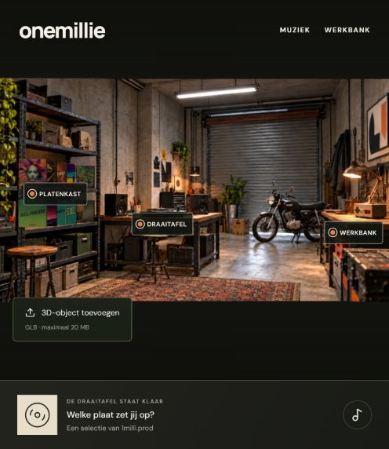
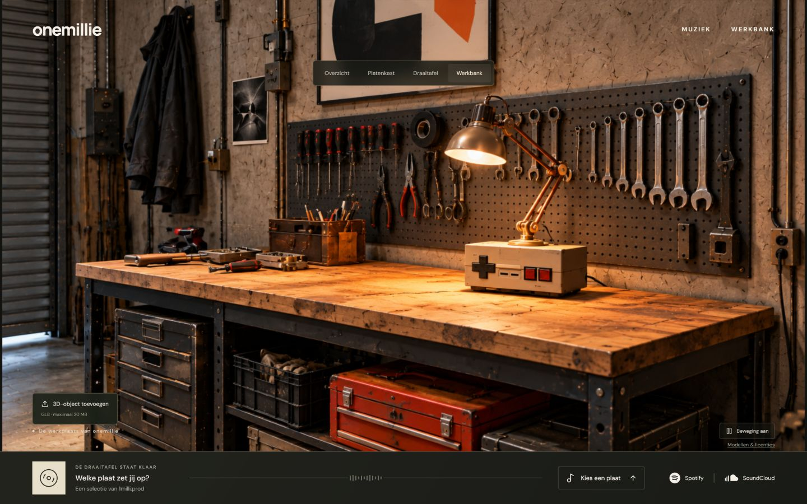

# onemillie

Werkbestanden voor de interactieve werkplaats, de assetkeuze-site en de eenvoudige desktopeditor.

**Status op 27 oktober 2026: er is nog geen ruimte in Unreal gebouwd.** Het Unreal-project bevat alleen instellingen, referenties en een importlijst. Er staat nog geen `.umap`-scène in deze repository. De afbeeldingen hieronder zijn van de websitepreview, geen Unreal-renders.

De gewenste eindversie is een echte 3D-kopie van de referentieruimte: dezelfde geometrie, verhoudingen, plaatsing, materialen, licht en camera. De eerdere assetselectie mag niet leiden tot een andere, willekeurig ingerichte ruimte. Eerst volgt een visuele vergelijking vanuit dezelfde camerahoek.

De actuele taken, alle gekozen modellen en aantallen, vaststaande ontwerpkeuzes en controlepunten staan in het [werkplan](docs/werkplan.txt). De [bestandscontrole](docs/progress-evidence.json) vermeldt afzonderlijk wat daadwerkelijk aanwezig is. Een Heartbeat in de bijbehorende Codex-chat hervat het werk iedere 30 minuten; dit is geen GitHub Actions-taak.

## Projecten

| Map | Inhoud | Status |
| --- | --- | --- |
| `onemillie-runtime` | Website met platenkast, LP-animatie, werkbankaanzicht en GLB-objectbeheer | Werkende tussenpreview; foto met beperkte diepte en echte 3D-objecten |
| `onemillie-keuzes` | Assetcatalogus met aantallen en opgeslagen keuzes | Broncode van de bestaande keuzecatalogus |
| `onemillie-studio` | Electron-editor voor plaatsen, verwijderen, draaien, schalen en groeperen | Broncode, 54 ruimteopties en 24 objectopties |
| `onemillie-unreal` | Unreal-projectinstellingen, oorspronkelijke referentie en gekozen modellen | Alleen voorbereiding; nog geen gebouwde omgeving |

## Preview



De hoezen staan met de voorkant naar de camera. De knoppen zitten bij de kast, draaitafel en werkbank; muisbeweging verplaatst of vervormt het beeld niet. Zie ook de [platenkastpreview](previews/front-facing-records.png) en [controle van deze wijziging](docs/ui-verification.json).



## Lokaal starten

Gebruik Node.js 22.13 of nieuwer.

Website:

```sh
cd onemillie-runtime
npm ci
npm run dev -- --hostname 127.0.0.1 --port 4270
```

Keuzecatalogus:

```sh
cd onemillie-keuzes
npm ci
npm run dev -- --hostname 127.0.0.1 --port 4271
```

Desktopeditor:

```sh
cd onemillie-studio/desktop
npm ci
npm start
```

De gekozen objectmodellen zijn meegeleverd. Extra ruimtebestanden worden vanuit de catalogus gedownload wanneer een directe download beschikbaar is. Niet-meegeleverde modellen staan in `onemillie-studio/research/optional-model-downloads.json`. Persoonlijke inrichtingen, browserprofielen en programma-installaties zitten niet in Git.

De optionele splatmaker is een afzonderlijke lokale dienst. Stel `ONEMILLIE_SPLAT_SERVICE` in op het pad naar die Python-dienst en eventueel `ONEMILLIE_PYTHON` op de Python-executable. De gewone 3D-editor werkt zonder deze dienst.

## Unreal

Open `onemillie-unreal/Onemillie.uproject` met Unreal Engine 5.8. De officiële Epic-plug-ins Unreal MCP en All Toolsets zijn geselecteerd. Lumen en hardware-raytracing zijn voorbereid, maar nog niet in de editor gevalideerd. De lokale MCP-server wordt niet automatisch gestart.

`Reference/requirements.txt` bevat de actuele bouwopdracht. `Import/chosen-assets.json` verwijst relatief aan dat bestand naar de meegeleverde modellen. Er is nog geen import uitgevoerd in Unreal en geen scène opgeslagen.

## Controle en licenties

De laatste lokale websitebuild en TypeScript-controle zijn geslaagd. De website heeft 11 geslaagde tests; de editor heeft 11 geslaagde tests. De mobiele preview is nog niet geverifieerd.

Modellen blijven onder de licentie van hun makers. Zie `onemillie-runtime/public/assets/credits.html`, de catalogusbestanden en `onemillie-studio/research/included-models.json` voor bron, maker en licentie. Muziekhoezen vallen niet onder de licenties van de 3D-modellen. Imagegen-prompts voor de websitebeelden staan in `onemillie-runtime/docs/concept-image-prompts.txt`.

Een push naar deze repository publiceert geen website. De website gebruikt een server voor gebruikersbeheer en opgeslagen keuzes en is geen statische GitHub Pages-site.
